# Практическая работа №4: Оркестрация и деплой веб-сервера с помощью Ansible

## Выполнил: [Абубакиров Артур]

### Шаг 1. Подготовка инфраструктуры и создание второй ВМ
- Отключено фоновое расписание в `cron` на первой ВМ.
- Выполнено полное клонирование виртуальной машины (`ubuntu-vm2`) с обязательной рандомизацией MAC-адресов.
- В диспетчере сетей VirtualBox создана общая «Сеть NAT» (`NatNetwork`) с подсетью `10.0.2.0/24` и включенным DHCP-сервером.
- Настроен проброс портов:
  - Порт `2222` хоста -> порт `22` VM-1 (SSH Control Node).
  - Порт `2223` хоста -> порт `22` VM-2 (SSH Managed Node).
  - Порт `8080` хоста -> порт `80` VM-2 (HTTP веб-сервер).
- Обе виртуальные машины переведены на использование адаптера «Сеть NAT».

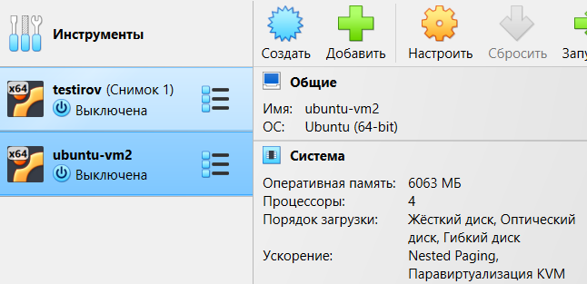
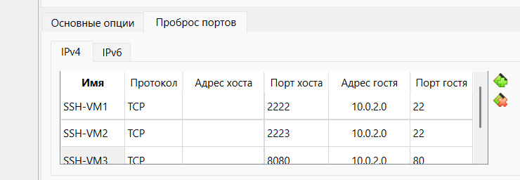
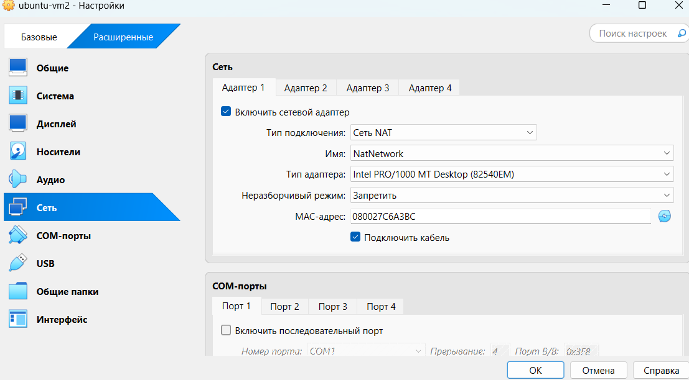

### Шаг 2. Настройка сетевой связности и SSH-доступа между ВМ
- Обе машины запущены в общей сети `NatNetwork`.
- Проверены назначенные сетевые адреса через `ip addr`.
- Проверена сетевая доступность между узлами командой `ping`.
- На управляющем узле (VM-1) сгенерирована пара SSH-ключей.
- Публичный ключ скопирован на целевой узел (VM-2) с помощью утилиты `ssh-copy-id runner@10.0.2.16`.
- Протестирован вход по SSH без запроса пароля с управляющего узла на целевой.

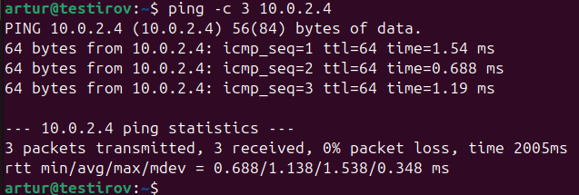
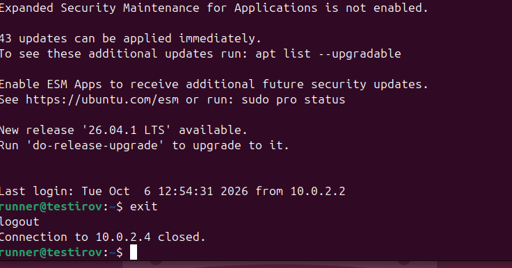

### Шаг 3. Установка Ansible и разработка базового Playbook
- На управляющем узле (VM-1) установлен пакет `ansible`.
- Создана рабочая директория `~/lab-ansible`.
- Сформирован инвентарный файл `inventory.ini`, описывающий группу хостов `[webservers]` с IP-адресом целевой машины (`10.0.2.4`).
- Написан сценарий `playbook.yml` для автоматической установки веб-сервера Nginx с повышением привилегий (`become: yes`).
- Выполнен проверочный тестовый прогон с ключом `--check`.
- Проведен успешный боевой запуск плейбука (`changed=1, failed=0`).

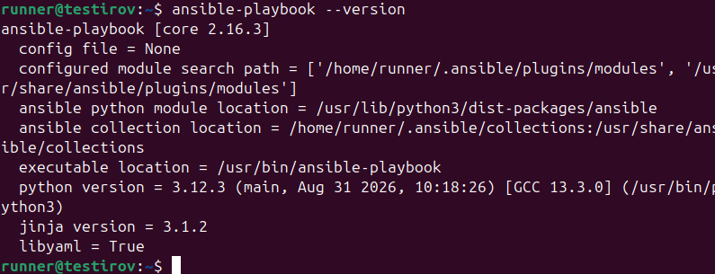
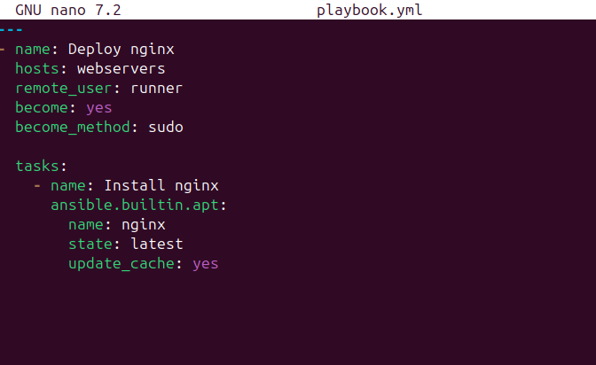
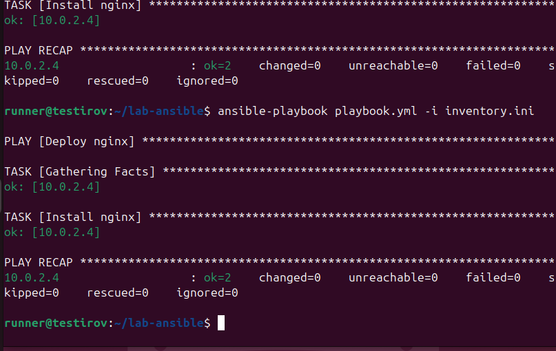

### Шаг 4. Доставка контента с помощью модуля `ansible.builtin.copy`
- На управляющем узле подготовлен шаблон главной веб-страницы `index.html`.
- В сценарий `playbook.yml` добавлена задача `Copy index`, копирующая локальный файл в директорию веб-сервера `/var/www/html/index.nginx-debian.html` с назначением прав `0666` и владельца `root`.
- Выполнен повторный прогон плейбука: продемонстрирована идемпотентность Ansible (задача установки вернула статус `ok`, а задача копирования — `changed`).
- Работоспособность развернутого веб-сервера проверена:
  1. Из консоли управляющего узла (VM-1) по локальному IP целевого сервера: `curl http://10.0.2.4`.
  2. Из браузера хостовой системы через проброшенный порт: `http://127.0.0.1:8080`.

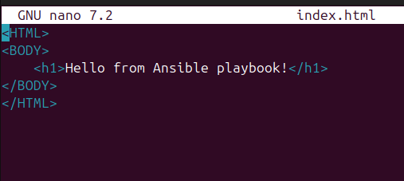
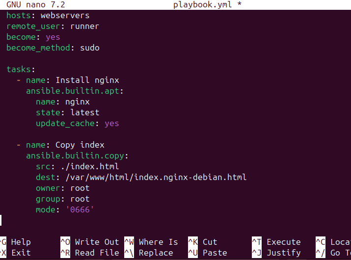
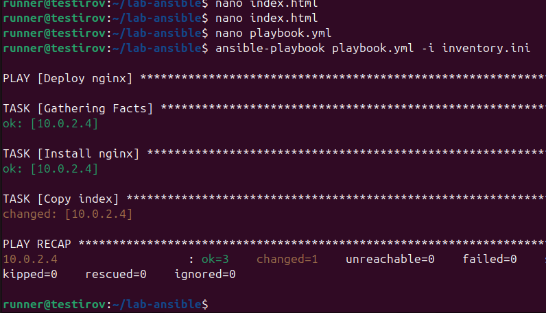
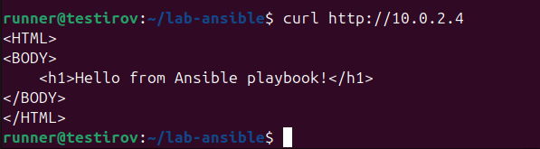
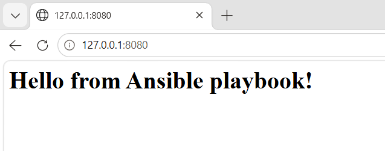
